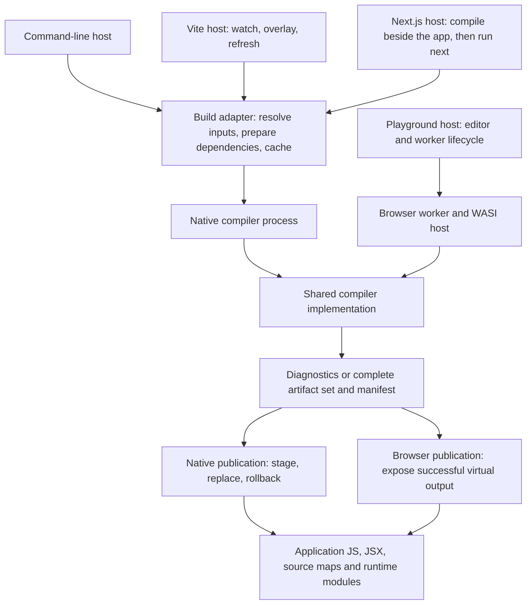
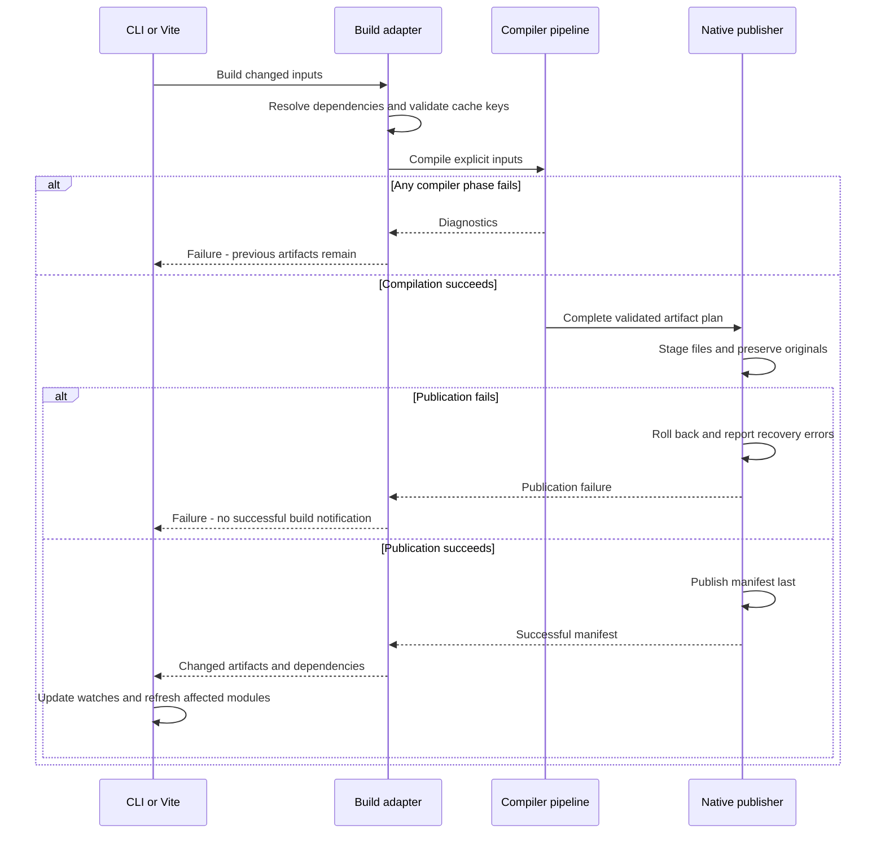

# Architecture

How rust-js is put together: what each part does, what it may not do, and
where a change goes. The [design decisions](README.md) say why each part
works the way it does; this page says where it is. The boundaries below
are executable: [architecture.test.ts](../test/architecture.test.ts)
checks each one. What isn't built yet is at [the end](#not-yet), and the
[roadmap](../ROADMAP.md) tracks it.

## Policies

### One pinned Rust toolchain per release

Each rust-js release supports one exact Rust toolchain. The current pin is
the stable release `1.99.0`; [rust-toolchain.toml](../rust-toolchain.toml) is the source of
truth. This follows [ADR 0003](decisions/0003-pin-nightly-toolchain.md) and
[ADR 0109](decisions/0109-stable-release.md).

The compiler uses rustc's internal APIs, THIR and MIR, so a toolchain upgrade
is a deliberate compatibility change. Update the pin, adapt frontend and
lowering assumptions, rebuild matching dependencies and WASI artifacts, and
run the conformance, snapshot, and native/browser parity suites together.
Compiler metadata and caches must not be reused across incompatible
toolchains.

Older application source may compile under the pinned frontend within our
supported language subset. That does not promise the behavior or diagnostics
of an older rustc. Rust editions and compiler versions are separate concerns.
Users needing an earlier toolchain use a matching earlier rust-js distribution.

Simultaneous support for multiple rustc versions is outside this architecture's
current scope. Do not add version-specific frontend adapters or another typed
Rust representation solely for hypothetical multi-version support.

### Modern JavaScript output; downstream compatibility

rust-js emits readable modern, standardized JavaScript, ES modules, and JSX
where requested by the program. It does not offer separate ES6, ES8, or
browser-specific code-generation modes. There is no internal JavaScript
compatibility or downlevel-transformation phase.

The application configures its JavaScript toolchain to transform syntax, process
JSX, bundle modules, and provide the runtime polyfills its deployment targets
need. Syntax transformation alone does not supply missing runtime APIs. Both
generated application code and emitted runtime helpers must pass through this
pipeline, with source maps preserved back to the Rust source.

| Responsibility | Owner |
| --- | --- |
| Rust evaluation order, copying, overflow, representations, and errors | rust-js |
| Readable modern JS/JSX, ES modules, semantic helpers, and source maps | rust-js |
| Browser targets, syntax lowering, JSX transformation, and module conversion | Application's JavaScript toolchain |
| Compatibility polyfills, bundling, minification, and code splitting | Application's JavaScript toolchain |

Modern output is a documented release contract, not permission to emit arbitrary
experimental syntax. Each release must declare its syntax baseline, required
runtime capabilities, and supported environments for direct execution without
transformation. New requirements need compatibility tests and release notes.

Not every capability can be supplied by ordinary downlevel transforms or
polyfills. For example, helpers currently use native BigInt arithmetic. The
supported deployment configuration must preserve those semantics or exclude
environments that cannot provide them. Choosing an old syntax target alone is
not proof of runtime compatibility.

Integration tests exercise representative downstream production builds and their
source maps. The playground must either run on an environment satisfying the
direct-execution contract or apply the same downstream transformations before
running generated programs.

## Hosts

Native and browser builds use the same compiler implementation. Hosts supply
inputs and consume results; they do not implement Rust semantics. The browser
uses a worker running the WASI compiler, with a supported virtual filesystem
and dependency set.



The native build adapter resolves the supported Cargo dependency graph, features,
bindings, compiler version, and toolchain. It produces explicit compilation
inputs. The browser host supplies equivalent inputs for its supported scope;
arbitrary Cargo build scripts and procedural macros are not implicitly promised
in a browser.

An app's Rust is compiled one way, `rust-js build`, its own process beside
the app's dev server, `next dev` or `vite`, which knows nothing of rust-js
(ADR 0412): it compiles the app's Rust once, each time it's run, to JS, JSX
and declarations beside it, as a Cargo build's copies are (ADR 0101), so
the dev server and its Fast Refresh see them as the app's own. The builder,
`checkCargo`, validates each manifest the compiler wrote. Installed
compiler and binding packages can be used without a source checkout.

## The pipeline

rust-js reuses rustc for everything up to type checking and borrow
checking, as ReScript reuses OCaml's, and writes JavaScript from each
body's MIR, with its THIR read beside it:

```text
 .rs ─► rustc: parse, resolve, type check, borrow check ─► THIR, MIR (copied out)
                                                              │
 ┌─ front end: src/lower.rs, src/lower/ ──────────────────────▼──────────────┐
 │  analysis  ─► what the whole crate is: dictionaries, drops, laziness ...  │
 │  pipeline  ─► each function, lowered with its own FnCx                    │
 │  mir.rs    ─► each body's MIR, its blocks structured ─► our JS AST        │
 │               (src/js.rs); its THIR read for names, spans and facts       │
 │  tidy.rs   ─► that JS, written as a person writes it                      │
 └──────────────────────────────────┬────────────────────────────────────────┘
                                    ▼  owned output: no rustc types from here
 reachability, link, names, prepare (readability), output, publish
                                    ▼
 printing: to_oxc.rs ─► oxc ─► format.rs ─► .js + .js.map
```

Four layers. The arrows above are the order work happens in; a module uses
only the layers its row allows. The architecture test resolves each
module's `crate::` and `super::` paths and checks them against this table:

| Layer | Modules | May use | May not |
|---|---|---|---|
| Driver | `main.rs`, `command.rs`, `cargo.rs`, `panic_runtime.rs` | every layer | |
| Front end | `lower.rs`, `lower/`, `jsx_syntax.rs`, `jsx_syntax/` | the front end, owned output | publish files; link |
| Owned output | `js.rs`, `program.rs`, `comments.rs`, `link.rs`, `reachability.rs`, `names.rs`, `prepare.rs`, `prepare/`, `output.rs`, `publish.rs`, `manifest.rs`, `library.rs`, `runtime.rs`, `settings.rs`, `hooks.rs`, `paths.rs` | owned output | use rustc |
| Printing | `to_oxc.rs`, `format.rs`, `typescript.rs`, `prettier.rs` | printing, owned output | be bypassed: only they print a module's JS and declarations, by oxc or TypeScript, and lay them out, by oxfmt or the app's Prettier; a manifest's JSON and the `#[test]` runner's imports and calls are the artifact planner's |

Two owned modules start printing, and are named as its exceptions:
`output.rs` prints each module it plans, its JS by oxc (`to_oxc.rs`) and
its declarations by TypeScript (`typescript.rs`, ADR 0207), and has the
app's Prettier lay them out (`prettier.rs`, ADR 0381), the map moved to
its layout (`format.rs`); `hooks.rs` formats what a hook returns
(`format.rs`). Another exception is a change
to this table and its test. Within a layer, no modules use each other in
a cycle: a helper more than one needs, as `paths.rs`'s, has its own home.

**Who owns each phase.** A failure at any phase produces diagnostics and
prevents publication; rustc remains the authority on Rust validity. THIR
and MIR are captured before rustc's analysis consumes them, but capturing
a body doesn't authorize emitting it: lowering starts only once the
analysis gate passes.

| Owner | Owns | Does not own |
| --- | --- | --- |
| Driver | Compiler invocation, rustc callbacks, phase sequencing, diagnostic gates | Feature lowering or Vite behavior |
| Syntax expansion | JSX-to-Rust syntax translation and source provenance | Bypassing Rust checks or deciding JS representations |
| Analysis | Definition indexes, validated bindings, trait and representation facts, item names and reserved imports | Mutable function state, emission, filesystem writes |
| Lowering pipeline | Work scheduling, demand-driven codecs, Rust-specific retention policy and module assembly | Import alias resolution, the helpers a module asks for, publication |
| Lowering | Rust-to-JS semantics, control flow, places, copying, evaluation order | Formatting, output paths, installation |
| Linker | Symbol resolution, collision-free aliases, the helpers each module's code writes, completed linked output | Rust-specific retention policy, re-lowering bodies or changing expression semantics |
| Runtime catalog | Helper implementations and their exported names, one package module | Rust syntax recognition or host setup |
| Preparation | Readability transformations that preserve evaluation regions: `s += t`, a destructuring of side-by-side reads, no `else` after a branch that leaves, `a || b` of `a ? a : b`, a test without its `!!`, `return;` of `undefined`, no JSX attribute of `undefined`, a `&mut`'s handle as its getter and setter | New language semantics or predicted printer indentation |
| Printer adapter | oxc conversion and source-map generation (`to_oxc.rs`), layout by oxfmt and blank lines between statements (`format.rs`), and the spelling of a value only the parser can check, a `RegExp` literal; the crate's transforms of the laid-out JS and its `sourceMappingURL` are the artifact planner's | Rust type decisions, readability rewrites, a helper's meaning, choosing runtime imports, or artifact publication |
| Artifact planner | Filenames, collisions, manifest, each module's runtime imports, complete generated bytes, and which files an older build wrote are stale: in its output's directory, neither written nor read now, still as written by fingerprint | Rust semantics or editor lifecycle |
| Publisher | Carrying out the plan: staging, unchanged-file preservation, removing the files the plan calls stale, failure recovery | Compiler transformations, or deciding what's stale |

## Inside the front end

The front end turns one function's MIR into JS, its THIR read beside it
for names, spans and facts ([ADR 0364](decisions/0364-mir-lowering.md)).
`FnCx` holds what a function takes. Its state is grouped by concern, each
group read and written only by the module that owns it, which others ask:
what a generic item is given (`Given`), what writing to a `Formatter`
knows (`display::Writing`), what walks of types found (`TypeWalks`), the
recursive types being cloned (`cloning`), and what's dropped where
(`drops::DropState`). A body lowered from its MIR has a state of its own
beside it, `mir::State`: its temporaries, labels, captures, drop flags
and the places its `&mut`s are to. It's `mir.rs`'s: a module of `mir/`
touches only the fields the architecture test lists for it, `drops.rs` its
flags and what's made before one is set, `writer.rs` a writer's string.

State follows three lifetimes:

- **Compilation:** immutable definition and representation facts, shared by all
  functions. Any analysis cache has an explicit owner and input key.
- **Function:** local bindings, allocated names, scopes, and accumulated symbol
  and helper dependencies. Nested function contexts inherit only what they need
  and return their dependencies explicitly.
- **Body:** a MIR body's temporaries, made and not yet used, in the order
  they're made, and its blocks' labels: `mir::State`, never a shared
  scratch slot on the function context.

MIR says what runs, in the order it runs: each value in a temporary of its
own, each borrow, move and check. So the JS is correct as it's made, and
made readable only where that's proved to change nothing: blocks become
labeled blocks and loops (`mir/cfg.rs`), a temporary used once is written
where it's used where nothing runs between that could see it (`fold`), and
`mir/tidy.rs` writes the body as a person writes it, from the JS and what
lowering's `Hints` say of it.

Operation classification is side-effect-free. It identifies a supported
operation and its representation requirements before emission. Prefer rustc
identities and diagnostic items; unavoidable library-layout assumptions live in
one recognition boundary and have toolchain-upgrade tests. A lang item,
`LangItem::String`, is rustc's identity for what the language itself uses,
which any module may ask of `is_lang_item`; a std item known by its name, a
diagnostic item or a symbol, `sym::Target`, is recognition's alone, as a
rule holds.

Its modules come in two kinds.

**Questions, which emit nothing.** They read THIR, MIR's facts and types,
and answer. Each is checked to stay that way.

| Module | Answers |
|---|---|
| `recognition.rs`, `recognition/` | Which std function or method a call is, a `Std`: `classify` asks what's known by identity, then a trait's method, then a type's own; and std's names and layout, `StdItem`, `cell_value_field`, `deref_target` |
| `body_queries.rs` | What a body has, found once before it's lowered: `for` loops, the indexes a condition shows in bounds, the callbacks a hook is given, the casts of whole numbers, the statics it reads |
| `drops/types.rs` | What dropping a type runs, and what a pattern moves, asked through a `DropQuery`: types, the crate's facts, which type parameters have drops, and the bounds of the dictionaries given, never `FnCx` |
| `drops/facts.rs` | What's refused of a body's values with destructors, and its momentary borrows, found before it's lowered, from a `DropQuery` and the body's THIR |
| `analysis.rs`, `analysis/` | What the whole crate is, before any function is lowered: what it refuses, the names its items have in JS, the types it changes in place, its drops' and `Debug`'s needs |
| `shortcuts.rs` | Nothing of its own: `self.is_map(ty)` for `self.recognition().is_map(ty)`, each question answered in `recognition.rs` |
| `std_coverage.rs` | How much of std's data structures rust-js knows: each stable method of each in `recognition/registry.rs`, `+` where `classify` knows it, for the ratchet in `docs/std-coverage.txt` (ADR 0314); and what each method's body in std is made of, through the MIR the toolchain ships, `safe`, `spec`, `opaque`, `memory` or `none` (the `std-bodies` draft) |

**Lowering of Rust's constructs.**

| Module | Lowers |
|---|---|
| `mir.rs` | A body from its MIR: its statements and terminators, places, calls (`mir_call`), aggregates, and the `&mut`s given to a call; temporaries folded where they're read |
| `mir/cfg.rs`, `mir/drops.rs`, `mir/awaits.rs`, `mir/iter.rs` | A MIR body's control flow, made labeled blocks and loops; what each `Drop` drops, by rustc's drop elaboration, and its flags; `.await`; iterators, lazy as Rust's adapters are |
| `mir/hints.rs` | What tidy is told of a body that its THIR says (`written`): where each `if`'s condition, `&&`, `if` of a `continue`, loop and table `match` is written; and the names of `bool`s and of integers (`typed_names`). A question: it emits nothing |
| `mir/writer.rs` | A writer's `Formatter` from MIR, and its body's end (`writer_epilogue`): which locals are it, its `Debug` builders, what's refused of it, and a call that writes to it, whose JS `display.rs` writes |
| `mir/calls.rs` | A call of what isn't std's: a closure's, a binding's, the crate's own function's, and an operator's that assigns through a `&mut` |
| `mir/std_calls.rs` | A std call of its values and places, by its kind: `format_args!`'s parts, text, a map's, a `Vec`'s or a slice's, an iterator's, a place's, a value's, each saying `None` to the rest |
| `mir/tidy.rs`, `mir/tidy/` | The JS of a body from its MIR, written as a person writes it: each rewrite changes nothing that runs. `tidy.rs` is the order of the passes, what they're told (`Hints`), and the facts they share; each concept's passes are a module of `tidy/`: `jumps.rs` (exits, labels), `loops.rs`, `branches.rs` (tests, chains, a value each branch gives), `bindings.rs` (declarations, aliases, temporaries and their names), `destructuring.rs`, `values.rs` (arrays, handles, callbacks, cells), `decisions.rs` (a match MIR tests as a tree, an `if` chain of its arms), `flags.rs` (drop flags where they're known, and their names), and `unwinds.rs` (a scope's drops on a panic, one `try { .. } finally { .. }`) |
| `lower.rs` | `FnCx` and its state, and what every module shares: diagnostics, names, constants |
| `bodies.rs` | Entering and leaving a body inside the one being lowered, a closure's or a copied default's |
| `patterns.rs` | A pattern's JS, a binding's or a parameter's, and its defaults |
| `loops.rs`, `places.rs` | A `for` over the crate's own `IntoIterator`; a place that's leaked |
| `calls.rs` | What calls share: `Call`, a call made; `apply`, calling a function value; `catching`, a JS call that may throw made a `Result` (ADR 0035); `given_to_js` |
| `mut_refs.rs` | A `&mut` to a value JS can't change in place, given to a call or given back by one: a box, the place, or a std call's items |
| `drops.rs`, `mir/drops.rs` | Destructors: what each drop runs and the drop functions it's written in (`drops.rs`); where and when a body drops, by rustc's drop elaboration of its MIR, and its flags (`mir/drops.rs`, ADR 0364); a std function lowered in place drops its own in a `try`'s `finally` |
| `representation.rs` | How each Rust value is represented: its shape, an `Option`'s payload, a cell, a number |
| `copies.rs` | When a value is copied: where it's read, if something changes one of its kind in place |
| `support.rs` | What rust-js can represent, and the error where a value it can't is made or bound |
| `refusal.rs` | How a refusal is said, `refuse` and its `words`: "rust-js does not support .. yet", and of addressable memory, that (ADR 0390) |
| `aggregates.rs` | Structs, variants and tuple structs made, by fields or a struct update, and constructors as values |
| `pointers.rs` | A raw pointer, a handle on its place, `$ptr(object, key)` or `$ptrTo(object)`, or `null`: what a pointer is taken to, `*p`, std's functions of one, and what's refused, an address, or a place JS may hold a copy of (ADR 0407) |
| `plain.rs` | Plain data, numbers, `bool`s and `char`s in tuples, arrays and structs, at rustc's offsets for wasm32: `layout`, the one answer of a type's layout; a `transmute` of plain data, its bytes as another type's; a zeroed value (ADR 0408) |
| `unions.rs` | A union, the object of the one field it holds: its fields read, written and copied, rust-js's error where one's read as another type's (ADR 0406) |
| `std_types/` | std's data structures and values, one module each, as its `mod.rs` tables them: `vec.rs` and `slice.rs` (`Vec`, `VecDeque`, slices, arrays), `map.rs`, `heap.rs`, `text.rs`, `number.rs`, `option.rs`, `result.rs` (`?` and the `From` of its error), `cell.rs`, `rc.rs`, `cow.rs`, `once.rs`, `lazy.rs`, `range.rs`, `channel.rs`, `pin.rs`, `uninit.rs`, `any.rs`, `process.rs` (Node's process, the one list of what works in Node only, ADR 0391), `path.rs` (a path's methods, over its components, ADR 0405); and `values.rs`, which hands a std call to its type's module (ADR 0314). A rewrite tidy makes of a type's helpers is the type's module's, which tidy calls: a map's counted entry (`map::counted_entries`), a range made as stepped (`range::range_items`), a cell's borrow none can fail (`cell::unguarded`) |
| `iterators.rs`, `combinators.rs` | Iterator chains and what ends them, and whether a value is a JS iterator or an array; `Option`'s and `Result`'s combinators, and more adapters |
| `items.rs` | References to items: what a function or a binding is in JS, whether it's the crate's, which impl a call runs |
| `traits.rs`, `std_impls.rs`, `ordering.rs` | Traits: dictionaries, evidence, `dyn`, calls of an impl's method; `Clone`, `Default`, `PartialEq`, `Ord` |
| `display.rs`, `format_args.rs`, `format_spec.rs` | `Display` and `Debug`, `format_args!`, placeholders' options |
| `serde.rs`, `serde/` | serde's derives and serde_json |
| `shipped.rs` | The API of a crate rustc builds that rust-js writes the JS of, as it writes std's: memchr's searches, over the byte arrays slices are (ADR 0529); which crates are such, and at which versions, is Cargo's catalog's, `cargo::READ_AS_RUSTC_BUILDS_THEM` |
| `jsx.rs`, `jsx_api.rs`, `bindings.rs`, `binding_calls.rs`, `untagged.rs`, `liveness.rs` | JSX, bindings to JavaScript and a binding's call, and untagged enums, told apart by their payload's kind (ADR 0214); and what JS reads, the fields of a struct given a binding, which rustc's dead-code lint can't see (ADR 0440) |
| `declarations.rs` | A module's TypeScript declarations, what it exports as Rust types it (ADR 0196) |
| `library.rs`, `sources.rs`, `pipeline.rs` | Libraries' contracts, source files, and the crate as a whole |

**Who owns what.** A concept that more than one module needs has one
module that owns it: its state, the questions about it, and the JS it's
written as, which the others ask for. [architecture.test.ts](../test/architecture.test.ts)
holds the ones below to it, and checks that each function the table names
is there; `bun run architecture` shows where each stands: what's read
outside its owner, and how much each module knows of the rest.

| Concept | Owner | What the others ask |
|---|---|---|
| What lowering from MIR found of a body's variables, `mir::Found` (ADR 0364) | `mir.rs` | `alike_local`, `plain_local`, `note_tested`, `note_falsy` |
| What dropping runs, and where | `drops.rs`, `drops/` | `drop_value`, `item_drop`, `drop_function`, `enter_body_drops` |
| Whether a value is a JS iterator or an array, and its JS: `Iterator.from`, a range's `$iterator` (ADRs 0061, 0364) | `iterators.rs` | `is_js_iterator`, `js_iterator`, `from_iterator`, `stepped`, `stepped_by`, `stepped_range` |
| Whether a generic iterator is given as it is, and its `Iterator` dictionary, `{ next }` (ADR 0411) | `iterators.rs` | `given_as_it_is`, `iterator_dictionary`, `iterator_evidence`; which functions step one, `analysis/iterator_steps.rs` |
| An array's items stepped, `$iter`, and a generic iterator lent, `$lent` (ADR 0071) | `iterators.rs` | `stepped_items`, `is_stepped_items`, `iterated`, `lent_iterator`, `unlent` |
| `&mut`s to values JS can't change in place, given to a call: a box, `{ value: place }`, and what's copied back (ADR 0074) | `mut_refs.rs` | `boxed`, `copied_back`, `mut_borrowed`, `nested_mut_object` |
| Writing to a `Formatter`: its JS; of MIR, which locals are it and its builders (ADRs 0054, 0136) | `display.rs`; `mir/writer.rs` | `formatter_answer`, `written_of`, `builder_written`, `mir_writer_call` |
| What a function or a binding is in JS | `items.rs` | `fn_ref`, `js_ref`, `resolve_instance` |
| Dictionaries and evidence: where a given one is, by its bound (`EvidenceQuery`), and its JS | `traits.rs` | `dictionary`, `evidence_for`, `has_evidence`, `impl_call` |
| What a generic function was given: dictionaries, a copied default's arguments, type facts (ADRs 0049, 0145) | `traits.rs` | `in_impl_terms`, `given_evidence`, `given_type_fact`, `resolve_self_instance`, `enter_default` |
| The box of a `Some` that looks like `None` (ADR 0051) | `std_types/option.rs` | `some`, `some_value`, `some_literal`, `is_some_box` |
| When a value is copied | `copies.rs` | `copy_if_needed`, `contains_mutated` |
| A map's or a set's JS: a `Map` or a `Set`, and a call whose answer nothing reads, JS's own method (ADR 0059) | `std_types/map.rs` | `map_values`, `discarded_calls` |
| A cell, a thread-local's among them, and a module's own one made a plain `let` (ADRs 0025, 0270) | `std_types/cell.rs` | `cell_call`, `plain_statics` |
| Which std function a call is | `recognition.rs` | `classify`, and its answers through `shortcuts.rs` |
| Std's names and layout: which std item a type, trait or function is | `recognition.rs` | `StdItem`, `is_std_type`, `is_std_def`, `std_item`, `trait_method`, `cell_value_field`, `deref_target`, `debug_builder`, `builder_step`, `iterator_method` |
| Std's data structures, each by its name and where std defines it (ADR 0314) | `recognition/registry.rs` | `data_structures` |
| A trait dictionary's cache, apart from the runtime's helpers (ADR 0049) | `names.rs` | `dictionary_cache` |
| What a runtime helper is: one the package exports, the helper that declares a name, one whose call does only what its arguments do, one that names a place | `runtime.rs` | `exports`, `helper_of`, `is_pure`, `names_a_place` |

**Calls.** A call is lowered from MIR by `mir_call`, which hands it on by
what's called:

```text
 mir_call(f, args)                                   mir.rs
   ├─ a write to a `Formatter`, a `Debug` builder's step   mir/writer.rs
   ├─ a function value, `js::import!`, a struct update's `..Default::default()`
   └─ mir_call_values(f, its arguments' values)
         ├─ an iterator's method                     mir/iter.rs: mir_iter_call
         ├─ a trait's method of the crate's, or a dictionary's
         │                                           traits.rs: trait_call
         ├─ a closure, `a += b` through a `&mut`     mir/calls.rs
         ├─ a binding                                mir/calls.rs: mir_binding_call,
         │                                           binding_calls.rs: binding_values
         ├─ the crate's own function                 mir/calls.rs: mir_crate_call,
         │                                           items.rs: fn_ref
         └─ one of std's: classify(f) = Some(known)
               └─ mir_std_call(known): what every std call must keep (drops,
                  a `fmt::Error`, `Option` boxing)
                     ├─ of its values and places, by its kind
                     │                               mir/std_calls.rs: mir_fmt_call,
                     │     mir_text_call, mir_map_call, mir_vec_call ..
                     └─ of its values alone: std_values(known)
                                                     std_types/values.rs
                           └─ the module of its type: std_types/vec.rs  slice.rs
                              option.rs  cell.rs  number.rs  text.rs  map.rs ..
                              iterators.rs  combinators.rs  format_args.rs ..
```

`std_values` names every `Std` variant, so a new variant is a compile
error until something lowers it. `mir_call_values` and `mir_std_call` are
held to the lengths they have: what's new goes to its type's module, not
the dispatcher.

**Iterators.** Whether a value is a JS iterator or an array is one
question, `iterators::is_js_iterator`, asked of the JS lowering from MIR
makes: a chain stays a JS iterator, whose helpers are lazy as Rust's
adapters are, until something ends it ([ADR 0139](decisions/0139-lazy-chains.md),
[ADR 0364](decisions/0364-mir-lowering.md)). Only `iterators.rs` writes or
takes apart `Iterator.from` and a range's `$iterator`.

**Runtime helpers.** The JS that generated code imports from
`@rust-js/runtime`: each is a file, `src/runtime/<name>.js`, which
`runtime.rs` names and orders, and the package is made from them
([ADR 0103](decisions/0103-runtime-package.md)). Lowering writes a helper
by the name it exports, `Expr::helper("$cmp")`, which checks the runtime
has it; the linker asks for the helper behind each name a module's tree
reads, and `output.rs` imports the ones its prepared tree reads, which
the printer is given. A name the compiler makes for a module of its own,
a dictionary's cache, is never a name the runtime exports
(`runtime::exports`).

## Owned output and source origins

The JS tree remains small and independent of rustc and oxc. It names the
fields of the values it models: what a box, a cell or a handle holds,
`js::HELD`, and a `dyn` pair's dictionary, `js::DICTIONARY`; no module
spells them, as the architecture test holds. Lowering may use rustc
types internally, but completed phase outputs do not expose `TyCtxt`, `DefId`, or
borrowed rustc source files to printing or publication.

Symbolic references use explicit symbol identities rather than special strings
masquerading as JavaScript identifiers. Linking resolves them into ordinary
names. The linked output contract forbids unresolved references: the
artifact planner refuses a module that holds what only an earlier phase
resolves, a symbol, a function's hole, a drop's argument, a handle, an
`import()` without its specifier (`js::Module::unprintable`), before it's
printed.

Source origins use compiler-owned file identities and spans. They retain the
origin of copied trait bodies, macro expansions, and cross-module code, so output
is not restricted to one source file per generated module. JSX expansion and
formatting preserve or explicitly remap this provenance.

Use named phase outputs to make ownership visible: captured input, analyzed
facts, lowered modules, linked modules, and artifact plan. Introduce only the
types needed to enforce real invariants; avoid parallel copies of every tree.

## Libraries

A library rust-js compiles is JS of its own, with a versioned manifest of
what crosses to its consumers: exported representations, trait evidence,
symbol identities, and runtime ABI
([ADR 0100](decisions/0100-separate-crates.md)); Cargo runs each crate's
compilation ([ADR 0101](decisions/0101-cargo-workspace-wrapper.md)). rustc
metadata alone is not a substitute for JavaScript linkage information. A
manifest from another build, or a library a consumer wasn't told of, is
refused. Compiled output is reusable only when its source inputs,
dependencies, features, target options, compiler, toolchain, and ABI
versions agree.

## Publication

A versioned manifest is the contract between compiler and hosts. Named producer
types and validating consumers agree on sources, modules, imports, artifact
paths, fingerprints, and compiler/ABI identity. Hosts reject incompatible
versions with an actionable error. Virtual paths are remapped as structured
fields, never by replacing text inside serialized JSON.



Each host keeps the same split: what's stale is the plan's to decide, and
the publisher's to remove, each still as written. `output.rs` decides, for
both compilers: natively, `publish.rs` removes; a WASI compiler, given the
older manifest by its host, says what's stale in the manifest it hands it,
and the host's `publishArtifacts` removes them but for a link to what's
written, which the compiler can't see
([ADR 0375](decisions/0375-the-compiler-says-what-is-stale.md)); and a Cargo build's copies
beside each module's Rust are decided by `writeInSource`, from a ledger of
what they are in place of a manifest, and published by the same `commit`
([ADR 0101](decisions/0101-cargo-workspace-wrapper.md)).
Native multi-file publication provides rollback for ordinary I/O failures; it
does not claim crash-atomic replacement across all files. Cleanup removes only
obsolete artifacts still matching their recorded ownership fingerprints.
Browser compilation writes into a fresh virtual filesystem and exposes the
result only after success. Browser and native results obey the same semantic
contract despite these different publication mechanisms.

The playground's execution frame is a separate trust boundary from its compiler
worker and editor. Untrusted programs run in an isolated origin or appropriately
sandboxed frame, with validated messages and run identities. Worker cancellation
and preview recovery are host responsibilities.

## Where the code is

One compiler crate, whose module visibility and owned phase outputs keep
the boundaries; packages split only when independent reuse, dependency
isolation, or release needs justify it. Only the linker can construct the
`Linked` value artifact planning requires, and only artifact planning the
`ArtifactPlan` the publisher carries out. Build hosts consume the manifest
instead of inferring compiler output.

| Responsibility | Code |
| --- | --- |
| Driver and syntax | `src/main.rs`, `src/command.rs`, `src/cargo.rs`, `src/panic_runtime.rs`, `src/jsx_syntax.rs`, `src/jsx_syntax/` |
| Analysis and lowering | `src/lower/analysis.rs`, `src/lower/pipeline.rs`, `src/lower.rs`, `src/lower/` |
| Linking and runtime | `src/link.rs`, `src/reachability.rs`, `src/names.rs`, `src/runtime.rs`, `src/runtime/` |
| JS tree and presentation | `src/js.rs`, `src/prepare.rs`, `src/prepare/`, `src/to_oxc.rs`, `src/format.rs`, `src/typescript.rs` |
| Owned modules and source origins | `src/program.rs`, `src/lower/sources.rs` |
| Libraries, settings and hooks | `src/library.rs`, `src/settings.rs`, `src/hooks.rs`, `src/paths.rs` |
| Artifact planning, manifest and publication | `src/output.rs`, `src/manifest.rs`, `src/publish.rs` |
| Build adapter and native hosts | `tooling/build.js`, `tooling/manifest.js`, `tooling/cargo.js`, `tooling/cli.js` |
| Browser host | `wasm/web/compile-rust.ts`, `tooling/publish.js`, `wasm/web/compiler-client.js`, `wasm/web/compiler-worker.js`, `wasm/web/rust/compiler.rs` |
| Bindings: JS's builtins, the web's APIs, React, Node, Next.js, serde | `builtins/`, `webapi/`, `react/`, `node/`, `next/`, `serde/`; the crates shipped, each once, `tooling/crates.js`, which hosts and packaging read |
| Tests: what each kind checks | `test/corpus/` and `test/corpus.test.ts` (each program run natively and as JS, its JS a snapshot); `test/snapshots/` (examples' JS); `test/lowering.test.ts`, `test/jsx.test.ts` (a construct's JS); `test/compiler.test.ts` (native Rust beside the JS); `test/architecture.test.ts` (these boundaries); `test/sourcemap.ts` (a source map decoder) |

## Where a change goes

A std function or method rust-js doesn't know yet:

1. **Recognize it**: a `Std` variant, and where `classify` finds it, in
   `recognition.rs` or `recognition/methods.rs`.
2. **Lower it** in its domain's function: `std_types/vec.rs` for a `Vec`'s, `std_types/text.rs`
   for a string's, and so on. If it needs a runtime helper, add
   `src/runtime/<name>.js` and name it in `runtime.rs`.
3. **Prove it**: a corpus case in `test/corpus/`, compared with native Rust,
   and, of numbers, strings or chars, its row in the boundary matrices,
   `scripts/matrix.ts` ([ADR 0182](decisions/0182-boundary-matrices.md));
   mutations in its module's list in `scripts/mutations/`, each a bug its
   tests must catch;
   and a design decision in `docs/decisions/` if it's a new choice.

A new kind of value, construct or analysis goes with its kind above: a
question that emits nothing in a module of its own, checked as the others
are, and lowering in the module of the construct. Check the generated JS
reads as a person would write it, and run the checks
[CONTRIBUTING.md](../CONTRIBUTING.md) asks for before pushing, as
[AGENTS.md](../AGENTS.md) runs them.

## Not yet

The boundaries above hold today. These are targets: the
[roadmap](../ROADMAP.md) tracks the first four, and the third
architecture audit found the rest.

- **A numbered ES baseline and environment matrix** for running output
  directly, without the application's transformations (M1.1, M5.2).
- **General Cargo dependency graphs** compiled crate by crate (M8.1), and
  packaged releases beyond macOS arm64 (M4).
- **Measured budgets** for phase time, peak memory, generated bytes, and
  edit-to-refresh latency on application-scale workloads (M5.1).
- **Checks before a commit lands:** the check runs on each push to `main`,
  after it's pushed; nothing refuses a commit that fails it.
- **Short functions:** `mir_call` (118 lines), `mir_call_values` (301),
  `mir_std_call` (254), `mir_function` (414), `classify_inherent` (840),
  `classify_trait_method` (422), `comb_values` (691) and `mir_iter_call`
  (502) are held to their lengths, which the architecture test holds
  exactly, each lowered as what's left in it goes where its kind is.
